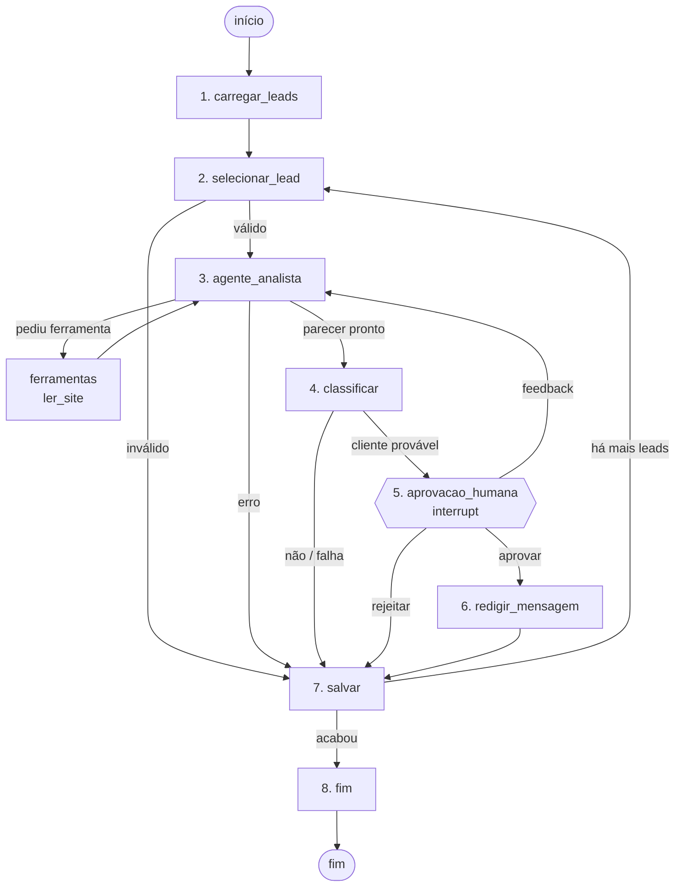

# Avaliador de leads com LangGraph

Agente que avalia empresas como possíveis clientes para uma software house: lê o site de cada uma, escreve um parecer, decide se é cliente provável, **pausa para um humano revisar** e, se aprovado, redige uma mensagem de primeiro contato. Nada é enviado automaticamente.

Projeto de estudo, construído para exercitar conceitos do LangGraph além do básico: laço agente ⇄ ferramenta, saída estruturada, *human-in-the-loop* com `interrupt()`, ciclo de feedback e persistência com retomada.

- **Stack:** Python 3.11 · LangGraph 1.2 · LangChain Core 1.6 · Gemini (`gemini-3.5-flash-lite`) · SQLite · pytest
- **Spec por etapa:** [fluxo.md](fluxo.md) · **Plano e estado da implementação:** [plano.md](plano.md)

---

## Como funciona


<sub>Diagrama equivalente ao gerado por `grafo.get_graph().draw_mermaid()`.</sub>

| # | Nó | O que faz | LLM? |
|---|---|---|---|
| 1 | `carregar_leads` | Lê a planilha de leads, filtra (tem site, não contatado, não processado), ordena por score, pega os N primeiros | Não |
| 2 | `selecionar_lead` | Pega o lead da vez, valida (guardrails) e **limpa o contexto** do lead anterior | Não |
| 3 | `agente_analista` + `ferramentas` | Agente decide se lê o site (`ler_site`), lê, e escreve um parecer em seções fixas | Sim |
| 4 | `classificar` | Transforma o parecer num veredito Pydantic (`cliente_provavel`, justificativa, oportunidade, confiança) | Sim |
| 5 | `aprovacao_humana` | **Pausa o grafo**; o humano aprova, rejeita ou devolve com feedback | Não |
| 6 | `redigir_mensagem` | Redige mensagem curta de primeiro contato; validada por código (tamanho, placeholders) | Sim |
| 7 | `salvar` | Grava o desfecho em `resultados.json` (idempotente) e **avança o laço** | Não |
| 8 | `fim` | Mostra resumo e as mensagens para enviar | Não |

Princípio de desenho: **o que é sempre igual fica em código e arestas; só o que exige julgamento vai para o LLM.** A ordem dos leads, filtros, limites e o laço são determinísticos; o modelo só decide o que ler, o que concluir e como escrever.

Todo caminho termina em `salvar`, com um de quatro status: `aprovado`, `descartado` (LLM disse que não é cliente), `rejeitado` (humano rejeitou) ou `pulado` (lead inválido ou erro, com o motivo).

---

## Como o LangGraph foi usado

### Estado e reducers — [`avaliador/estado.py`](avaliador/estado.py)
Um único `TypedDict` passa por todos os nós. Dois campos usam *reducers*:
- `mensagens: Annotated[list, add_messages]` acumula o histórico do laço agente ⇄ ferramenta. Para limpar entre leads, `selecionar_lead` envia `RemoveMessage(id=REMOVE_ALL_MESSAGES)` (devolver `[]` não limparia, porque o reducer acumula).
- `resultados: Annotated[list[dict], operator.add]` acumula um registro por lead.

### Laço agente ⇄ ferramenta (ReAct) — [`avaliador/grafo.py`](avaliador/grafo.py), [`avaliador/ferramentas.py`](avaliador/ferramentas.py)
- O modelo recebe a ferramenta via `bind_tools([ler_site])`; um `ToolNode` a executa (`messages_key="mensagens"`, já que o estado não usa a chave padrão `messages`).
- `rota_analista` é uma aresta condicional: se a última resposta tem `tool_calls`, vai para `ferramentas`; senão, segue para `classificar`.
- **Limite de 3 leituras por rodada**: atingido o limite, o analista é chamado mais uma vez pedindo o parecer final, e pedidos extras de ferramenta são descartados. `recursion_limit` no config é a rede de segurança.
- `ler_site` usa **`InjectedState`** para ler o lead atual do estado sem expor esse parâmetro ao LLM, e com isso **recusa qualquer domínio que não seja o do lead**. Se o site estiver fora do ar, devolve os indicadores do cache do pipeline de prospecção.

### Saída estruturada — `classificar`
`llm.with_structured_output(Veredito)` obriga o modelo a responder num schema Pydantic. A aresta seguinte roteia por um campo booleano, não por texto. Regras de consistência são aplicadas em código (ex.: parecer com confiança baixa nunca vira veredito com confiança alta).

### Chain LCEL — `redigir_mensagem`
`ChatPromptTemplate | llm | StrOutputParser()`, com validação determinística da saída e uma nova tentativa informando ao modelo o que estava errado.

### Human-in-the-loop — `aprovacao_humana` e [`main.py`](main.py)
- O nó chama `interrupt(payload)`: o grafo para e o estado fica salvo no checkpointer.
- A CLI mostra parecer e veredito, lê a decisão e retoma com `graph.invoke(Command(resume=decisao), config)`.
- **Ciclo de feedback:** com "feedback", o texto do revisor entra em `mensagens` como `HumanMessage` e uma aresta volta para `agente_analista`. O analista vê o próprio parecer anterior mais a correção, pode reler o site e reescreve. Máximo de 2 revisões por lead.
- Ao retomar, o nó roda de novo desde o início e `interrupt()` devolve a resposta; por isso nada antes dele tem efeito colateral.

### Persistência e retomada — `SqliteSaver`
- Cada execução tem um `thread_id` próprio. Se a última execução não chegou ao fim (`graph.get_state(config).next` não vazio), a CLI retoma de onde parou — inclusive depois de fechar o terminal.
- `salvar` é **idempotente** (substitui o registro de mesmo `id`, escrita atômica), porque um nó pode ser reexecutado se o processo cair entre a gravação do arquivo e o checkpoint.

### Segurança do agente
- Conteúdo do site é tratado como dado: o prompt instrui a ignorar comandos vindos dele, e a ferramenta só acessa o domínio do lead. Testado com uma página local contendo injeção de prompt: o agente não seguiu a instrução nem tentou acessar outra URL.

---

## Estrutura

```
avaliador/
  config.py        caminhos, N, limites
  estado.py        Lead, Estado (reducers), Veredito (Pydantic)
  dados.py         leitura da planilha, resultados.json, cache de sites
  ferramentas.py   ler_site (InjectedState, validação de domínio, fallback)
  prompts.py       prompts do analista, classificador e redator
  grafo.py         os 8 nós, roteamento e montagem do StateGraph
main.py            CLI: inicia, pausa para aprovação, retoma
tests/             16 testes com modelos falsos
fluxo.md           spec de cada etapa com critérios de aceite
plano.md           plano em fatias e estado da implementação
```

`criar_grafo(llm_analista, classificador, llm_redator, auto, checkpointer)` recebe os modelos por injeção de dependência — é isso que permite testar o grafo inteiro com modelos falsos.

---

## Testes

```powershell
.\.venv\Scripts\python -m pytest -q
```
16 testes, sem rede e sem gastar cota (modelos falsos determinísticos). Cobrem: filtros e ordenação da carga; idempotência da gravação; recusa de domínio e fallback de cache na ferramenta; validação da mensagem; os quatro status; limite de chamadas de ferramenta; reset do contexto entre leads; aprovar/rejeitar; feedback que reanalisa e respeita o limite; retomada num **novo processo** a partir do SQLite.

Verificado também manualmente com o modelo real: rodadas completas na CLI (pausa, saída, retomada, feedback, aprovação, rejeição) e o teste de injeção de prompt.

---

## Como rodar

```powershell
python -m venv .venv
.\.venv\Scripts\python -m pip install -r requirements.txt
```
Copie `.env.example` para `.env` e preencha `GOOGLE_API_KEY` (gratuita em https://aistudio.google.com/apikey). O modelo pode ser trocado com `GEMINI_MODEL`.

```powershell
.\.venv\Scripts\python main.py            # 5 leads, com aprovação
.\.venv\Scripts\python main.py --n 2      # quantidade de leads
.\.venv\Scripts\python main.py --auto     # sem aprovação humana
.\.venv\Scripts\python main.py --nova     # ignora execução pausada
```
Na pausa: `a` aprovar · `r` rejeitar · `f` feedback · `s` sair (retoma na próxima execução).

> **Dados:** os leads vêm de uma planilha privada gerada por um pipeline de prospecção, que não está no repositório. Os caminhos são configurados no `.env` (`PLANILHA_LEADS`, `SCORES_LEADS`, `CACHE_SITES`). Os testes não dependem dela: criam uma planilha temporária com o mesmo formato. Para rodar a CLI com outros dados, aponte essas variáveis para uma planilha com aba `Leads` e as colunas listadas em `COLUNAS_OBRIGATORIAS` (`avaliador/config.py`), e um JSON `{ID: [score, ...]}`.

---

## Limitações e próximos passos

- Lê só o site; avaliações do Google ficaram fora do escopo.
- Processa um lead por vez; o próximo passo natural é paralelizar com a API `Send` (map-reduce).
- Não usa *time travel* (voltar a um checkpoint antigo e ramificar), outro conceito a explorar.
- A mensagem não passa por um segundo `interrupt()` de aprovação; é revisada no arquivo antes do envio manual.
